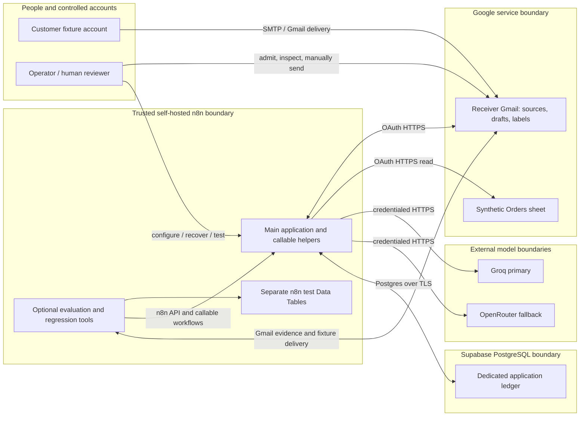
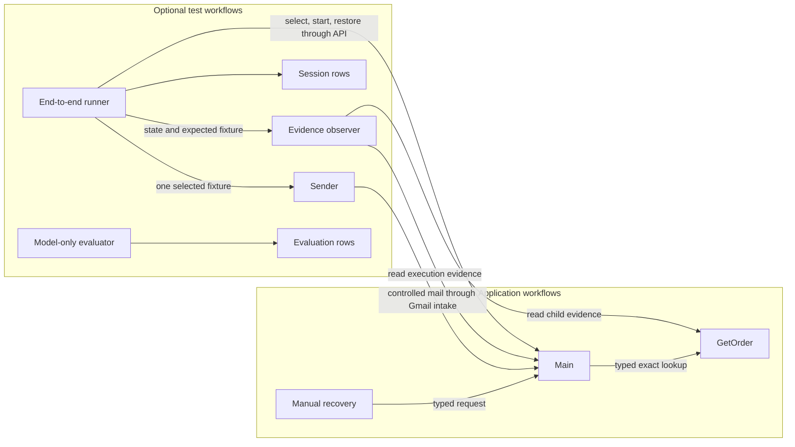
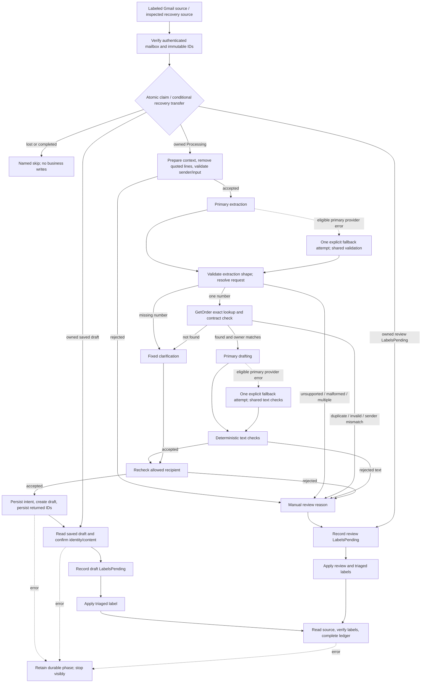
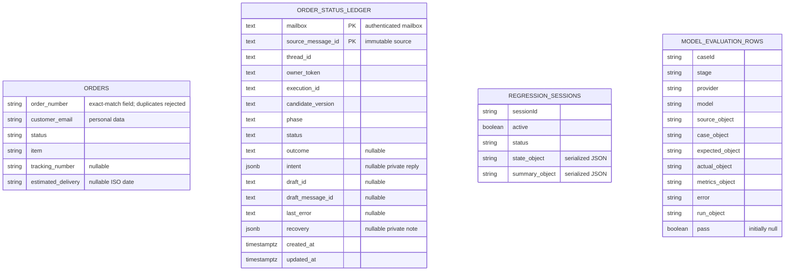
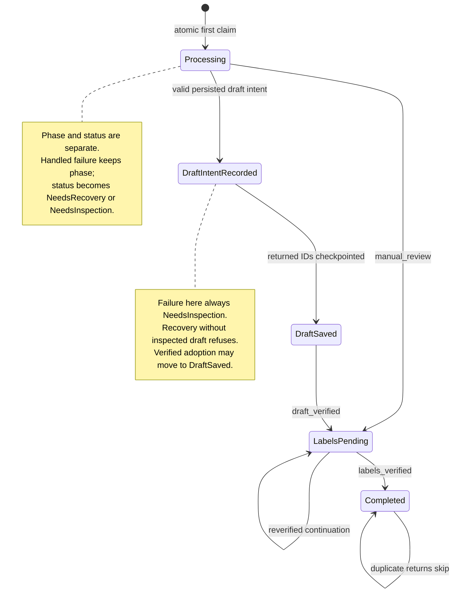
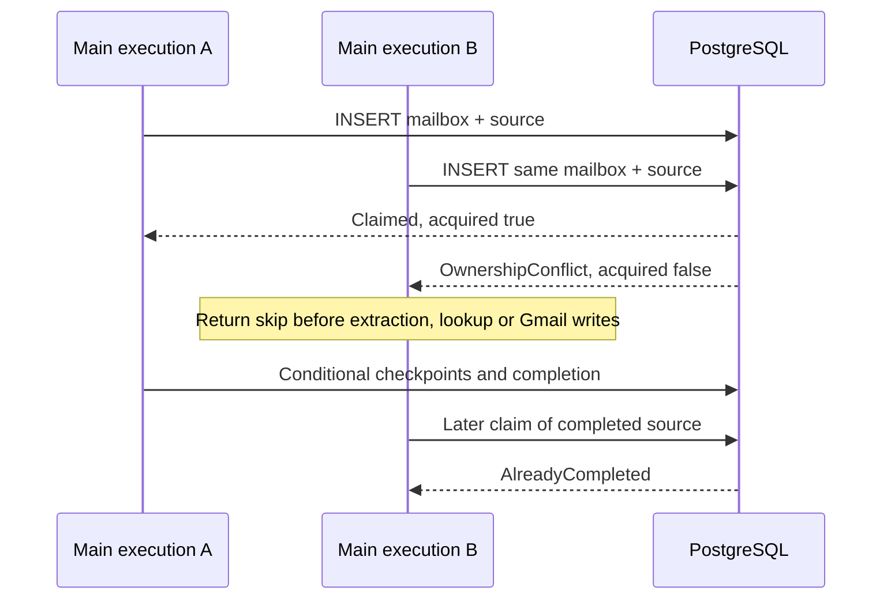
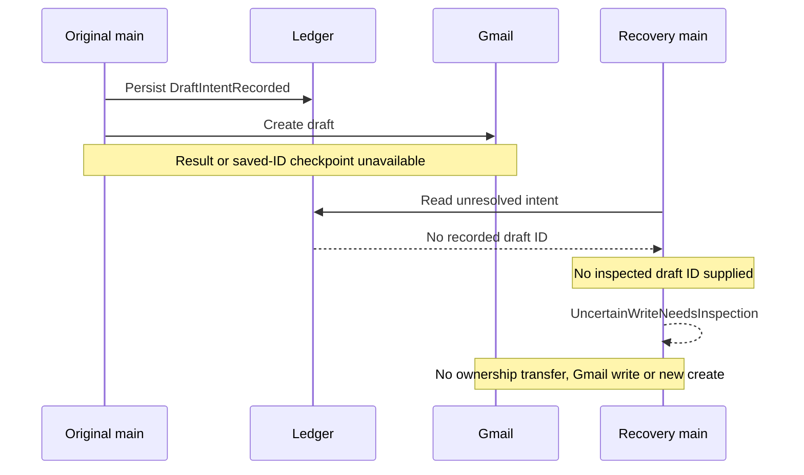

# Order-Status Reply Drafter — as-built system design

**Client as-built design · 2026-10-21 · Asia/Jakarta.** This copy describes the delivered, verified configuration. It is not a fresh live inspection and not a destination deployment. It carries the same architectural and contract explanations as the source design, with package-local evidence links.

**Where the facts come from.** When sources disagree, trust them in this order:

1. Executable sanitized exports and SQL.
2. Shared policy definitions and independent fixtures.
3. Dated verification records.
4. Historical plans.

The [main export](../deliverables/main-workflow.json), [GetOrder](../deliverables/get-order.json), [recovery](../deliverables/reliability/recover-order-status-request.json) and [ledger SQL](../database/order-status-ledger.sql) define the application baseline. The [reliability results](../deliverables/reliability/verification-results.json) and [regression results](../deliverables/regression/verification-results.json) show what was actually demonstrated.

A later source closure recorded a native main export that differs from the packaged one in omitted defaults and in presentation dimensions/position. Node names, connections, settings and groups were retained. The package keeps the verified delivered baseline. This document does not establish byte-for-byte parity with the current live workflow, and it does not record a new integration pass.

**How to use the documentation set.** Use this document for architecture and decisions, [setup](setup-and-rebinding.md) for procedures, and the [recovery guide](order-status-recovery-guide.md) for one interrupted request. This is the architectural reference for the package; the other guides cover procedures.

## Contents

1. [Purpose and boundaries](#1-purpose-and-boundaries)
2. [Context, deployment and seven components](#2-context-deployment-and-seven-components)
3. [Processing, phases and ten scenarios](#3-processing-phases-and-ten-scenarios)
4. [Data and interface contracts](#4-data-and-interface-contracts)
5. [Models and deterministic policy](#5-models-and-deterministic-policy)
6. [Transactions, ownership and concurrency](#6-transactions-ownership-and-concurrency)
7. [Failure handling and supervised recovery](#7-failure-handling-and-supervised-recovery)
8. [Security, privacy and access](#8-security-privacy-and-access)
9. [Verification and change management](#9-verification-and-change-management)
10. [Operations, deployment and handoff](#10-operations-deployment-and-handoff)
11. [Decisions, traceability and limits](#11-decisions-traceability-and-limits)

## 1. Purpose and boundaries

**The problem.** Support staff repeatedly answer “Where is my order?” by finding a record and turning its status into an email. This system does the lookup and prepares the reply, but a person still decides whether to send it.

**Who does what.**

- The **customer** supplies the question.
- The **operator** deliberately admits a message through a Gmail label, reviews drafts and unsupported cases, and reconciles failures.
- The **developer** configures credentials, resource mappings, business text and versioned tests.

**What the system accepts.** A message that has been deliberately labeled in the authenticated receiver's controlled Gmail mailbox, with:

- one allowed sender,
- plain-text English, and
- at most one distinct order number.

Orders come from a synthetic six-column Google Sheet. Attachments are not downloaded. Quote cleaning removes lines that start with optional whitespace followed by `>`. It is not a complete email-history parser, and it does not interpret HTML or attachments.

**What “done” means.** A source message ends in one of two business outcomes:

- `draft_ready`: one fixed clarification or one order-aware draft was saved in the source thread and read back successfully, the required source labels were verified, and the ledger reached Completed. A clarification is still only a draft for a person to review; it is not a sent question.
- `manual_review`: no draft was created, and both the needs-review and triaged source labels were verified before the ledger was completed. Review reasons stay in execution context; the labels do not encode the full reason.

**What “not done” means.** A skipped source (`AlreadyCompleted` or `OwnershipConflict`) authorizes no business processing. An unresolved technical failure is not a review success and must never be reported as completed. So, on top of the business routing requirements, reliability requires atomic ownership, durable write intent, saved identity, verified completion and supervised recovery.

**Out of scope for the delivered system:**

- real-store integrations,
- additional languages,
- multiple-order replies,
- attachments,
- autonomous customer sends,
- automatic recovery, and
- unattended production deployment.

The callable test Sender sends controlled fixture emails; it does not send customer replies. No measured savings, service-level objective or production capacity is claimed.

## 2. Context, deployment and seven components



**Boundary rule.** Only credentialed n8n code touches external systems; customer text never grants tool access. Two things cross boundaries: model input goes to the model providers, and private draft intent goes to the database. Normal polling needs outbound access to services only. It does not need a public webhook, a tunnel, the test runner or an evaluation table. Reachability of the admin UI/API and Google OAuth setup are installation concerns, and the tunnel used in the source environment is not an application dependency.

All seven delivered exports are inactive and stripped of credentials. The inactive flag in the export metadata does not mean callable dependencies can skip publication on the destination.

| Packaged workflow | Trigger/input → responsibility → output | Dependencies and credential types | Operational role |
| --- | --- | --- | --- |
| [DraftOrderStatusReply](../deliverables/main-workflow.json) | Gmail every-minute poll, or typed recovery `request` object → own, route, save/confirm/label → completed context or named skip; failures stop | Gmail OAuth2 (including profile HTTP request), Postgres, Sheets through GetOrder, Groq API, OpenRouter API; n8n API for previous execution during recovery | Application entry; publish/start deliberately for polling; stopped at final closure |
| [GetOrder](../deliverables/get-order.json) | Typed string `order_number` → exact matched-row validation → one lookup contract | Google Sheets OAuth2 | Published callable dependency; no poller |
| [RecoverOrderStatusRequest](../deliverables/reliability/recover-order-status-request.json) | Manual selection → call the same main recovery entry → main outcome | Bound main; external credentials live in main | Manual, inactive; no scheduler |
| [EvaluateOrderStatusModels](../deliverables/regression/evaluation-workflow.json) | Native Evaluation Trigger rows → select extraction/drafting stage and record scored result | Groq API; separate evaluation Data Table | Optional testing, inactive/unpublished; no Gmail or Orders path |
| [RunOrderStatusRegressionTest](../deliverables/regression/end-to-end/run-order-status-regression.json) | Manual configured mode → readiness, session ownership, fixture dispatch, observation, restoration → SuiteResults and session row | n8n API, receiver Gmail OAuth2, read-only Sheets OAuth2, sessions Data Table; GetOrder, observer and Sender | Optional test orchestrator; may temporarily start selected main; stays inactive between runs |
| [ObserveOrderStatusCase](../deliverables/regression/end-to-end/observe-order-status-case.json) | Typed `state` object → read actual source/thread and main/child execution evidence → `{result}` | Gmail OAuth2 and n8n API | Published callable read-only evidence helper; no business-route implementation |
| [Sender](../deliverables/regression/end-to-end/sender-callable.json) | Typed `subject`, `body`, `senderMode`, or manual fixture → exactly one selected delivery path → acceptance receipt | SMTP customer credential or receiver Gmail OAuth2 | Published callable test dependency; manual entry also available; no autonomous trigger |

The recipient package runs from sanitized exports and self-contained test assets. Build generators are not runtime dependencies, and they are neither required nor included. The source n8n application version and the destination's importer behavior are unverified. Supabase hosts the ledger only — not the Orders sheet, n8n internals or the test Data Tables.



**Component rule.** The tests reuse the real main application: recovery calls its shared paths, and the runner observes its real executions. The model-only evaluator has no call into the business graph. In the diagram, Sender's arrow means mailbox delivery, not a direct invocation of the main workflow.

## 3. Processing, phases and ten scenarios



Read this as a logical data-flow diagram, not an exact node graph. Fallback arrows send their result back to shared validation instead of repeating the primary call. Unexpected model, lookup or route errors also reach unfinished-work handling. Intake identity or claim errors can stop the run before an owned ledger row exists, so durable error recording is not universal.

### Canvas phases

The canvas has nine numbered phase notes, **00–08**. The verified main has 104 nodes, counting those notes.

| Phase | Responsibility |
| --- | --- |
| **00 Supervised recovery** | Read source, ledger and execution evidence, then reconcile |
| **01 Claim the source** | Authenticate and atomically acquire ownership |
| **02 Validate request** | Build stable context and validate input |
| **03 Extract and route** | Share schema and business resolution across providers |
| **04 Resolve order** | Exact lookup and sender consistency |
| **05 Prepare reply** | Model or fixed text, plus checks |
| **06 Save and confirm** | Recipient gate, intent, creation, saved IDs and readback |
| **07 Finish source labels** | Label verification and ledger completion |
| **08 Retain unfinished work** | Record a handled failure and stop |

Older six-phase counts do not describe this final canvas. The expanded swimlanes were kept on purpose, and a native top-level-box warning remains.

### Intake

The poller:

- uses the input label,
- excludes triaged messages and drafts,
- excludes Spam and Trash,
- reads either read state,
- downloads no attachments, and
- requests at most one result per poll.

`ReadMailboxIdentity` reads Gmail's authenticated profile. `VerifyMailboxAndSource` then:

- compares that profile with the configured receiver,
- checks that the message and thread IDs are nonempty hexadecimal,
- on recovery, checks the requested source identity, and
- checks the authorized intake label and the forbidden system labels.

This ties the ledger namespace to the credential's real mailbox rather than to caller-supplied text.

### Context and validation

After the claim, `PrepareSourceContext` keeps the immutable source IDs, the subject and the original plain body, together with the `Sample Shop` and `Sample Shop Support` configuration. `CleanCustomerQuestion` derives the cleaned body; it does not erase the original body from retained execution data.

`ValidateRequestInput` requires:

- one valid, normalized, bare mailbox from the parsed From header,
- that mailbox to be in the controlled allowlist, and
- nonempty cleaned input.

Model and Sheets nodes replace item contents. Explicit named-node references therefore restore the source context; the workflow does not trust the latest output to carry it forward.

### Extraction and routing

Extraction is checked before any business routing.

- **Repeated numbers count once.** Distinct digit strings are deduplicated, so repeating the same order number still means one order.
- **Missing number** → a fixed request for the number. This avoids a meaningless lookup.
- **Not found** → a fixed confirmation draft. This avoids asking a model to write without order facts.
- **Duplicate or invalid rows, or customer-email mismatch** → manual review. The mismatch route does not attach the order object to drafting context and does not call a drafting model, although the lookup evidence still exists privately in execution history.

### Drafting, saving and confirming

For a matched owner, the drafting model receives the verified facts separately from the cleaned customer text. Shared generated-text checks run first, and then the same save gate that fixed templates use. The steps after that must happen in this order:

1. `RecheckAllowedRecipient` confirms exact, normalized allowlist membership again after all transformations.
2. `RecordDraftIntent` must succeed before `SaveReviewDraft` runs.
3. The returned IDs must reach `RecordSavedDraft` before any readback.
4. `ConfirmSavedDraft` verifies the draft/message/thread IDs, the original subject, the trimmed plain text, exactly one intended To recipient, and no extra CC/BCC. An explicit `labelIds` array without DRAFT is rejected.

Verification does not detect changes that trimming removes, and it cannot prove semantic quality.

### Labels and completion

Only after confirmation can draft labels be marked pending. Reviews record their outcome before both labels are applied.

Source readback checks the exact source and thread and the required labels. It accepts both `labelIds` and Gmail's simplified `labels:[{id}]` form. It checks that required labels are present; it does not check for the absence of arbitrary labels or for removal of the input label. A successful completion blocks later processing twice over: through the triaged filter and through the durable completed key.

### The ten scenarios

| Case | Branch difference and completion |
| --- | --- |
| S01 shipped | One known order, matching sender → model uses status, exact tracking and qualified estimate → confirmed draft |
| S02 processing | Known processing order, blank tracking/timing → model says dispatch date unknown → confirmed draft |
| S03 delivered | Known delivered order with tracking, no estimate → no invented delivery date or unknown-timing discussion → confirmed draft |
| S04 missing | No number → no lookup or drafting model → fixed request-for-number draft |
| S05 unknown | Exact lookup `not_found` → no drafting model → fixed confirm-number draft |
| S06 refund | Unsupported intent → no lookup/drafting/save → review |
| S07 override | Instruction to ignore records → extraction manual review → no lookup/drafting/save |
| S08 ownership | Receiver-to-self passes controlled sender gate but differs from order customer → found lookup, no drafting/save → review |
| S09 multiple | Two distinct numbers → no lookup/drafting/save → review |
| S10 quoted | Quoted second number removed; active question resolves the same order as S01 → independent source claim and confirmed draft |

The [case definitions](../deliverables/regression/end-to-end/cases.json) and the [test table](demo-test-cases.md) give the exact inputs and expected templates. The ten-case expectation is six drafts and four reviews. Unsupported requests create no draft, not even a generic apology.

### Happy-path sequence

```mermaid
sequenceDiagram
  participant G as Gmail
  participant M as Main
  participant P as PostgreSQL ledger
  participant S as GetOrder / Sheets
  participant AI as Models
  G->>M: Labeled source and immutable IDs
  M->>G: Read authenticated mailbox
  M->>P: Atomic first claim
  P-->>M: Claimed
  M->>AI: Extract cleaned request
  M->>S: Exact order number
  S-->>M: Valid found order
  Note over M: Compare sender before drafting
  M->>AI: Draft from verified facts
  M->>P: Record DraftIntentRecorded
  M->>G: Create one draft
  G-->>M: Draft ID and draft-message ID
  M->>P: Record DraftSaved
  M->>G: Read draft
  Note over M: Confirm recipient, thread, subject, body
  M->>P: Record LabelsPending
  M->>G: Apply triaged; read source labels
  M->>P: Complete with labels_verified
```

Each database call commits separately, and Gmail creation sits between two database transactions. This ordering makes a missing create result visible as uncertainty.

## 4. Data and interface contracts

### Orders and lookup

The Orders sheet, columns A:F, must have exactly these headers. Import the synthetic [CSV](../deliverables/sample-orders.csv) as text. If cells get converted, unformatted Sheets output returns numbers or date serials, and the validator deliberately rejects those values.

| Field | Storage/normalized rule |
| --- | --- |
| `order_number` | Required string, trimmed digit-only; exact request equality; leading zeroes matter |
| `customer_email` | Required string, trimmed/lowercase; one bare dot-atom mailbox with DNS-style domain; total ≤254, local ≤64, domain labels ≤63 characters |
| `status` | Required string, trimmed/lowercase: `processing`, `shipped`, `delivered` |
| `item` | Required nonempty trimmed string |
| `tracking_number` | String trimmed or null/blank → null; numeric values invalid |
| `estimated_delivery` | String trimmed or null/blank → null; when present, real Gregorian `YYYY-MM-DD`, year ≥1, valid month/day/leap-year; numeric serial invalid |

**How GetOrder works.** `GetOrder` takes `{"order_number":"1001"}` as a typed string. `ReadAllOrders` reads A:F, all rows, with `returnFirstMatch:false` and unformatted values/date serials. An expression then selects the rows whose **string** order_number, trimmed, equals the request, and calls `validateOrder`. There is no fuzzy matching and no model-selected row.

One caveat: a numeric order cell is not a selected match, so it can produce `not_found`. Do not describe the validator as guaranteed to report `invalid_data` for every malformed row.

| `lookup_status` | `order` and diagnostics |
| --- | --- |
| `found` | Valid normalized six-field object |
| `not_found` | null; no matched string rows |
| `duplicate` | null; more than one match, before validating individual rows |
| `invalid_data` | null; `reason:"invalid_order_data"`, `invalid_fields` array naming bad fields in the single selected row |

The main workflow's `validateLookupResult` adds its own checks. It rejects unexpected statuses and non-object payloads, exposed facts on non-found results, and a found object whose order number does not match or whose customer email is not a string. It relies on the child for the full six-field validation. Sheets failures throw; they are never turned into “order not found.”

```json
{"lookup_status":"found","order":{"order_number":"1001","customer_email":"customer@example.com","status":"shipped","item":"Ceramic mug set","tracking_number":"TRK1001","estimated_delivery":"2026-10-20"}}
```

This is synthetic, like every example below. None of the examples was executed.

### Runtime context, extraction and outcomes

**Extraction schema.** The model must return:

- `request_type`: `order_update` or `manual_review`,
- `order_numbers`: an array of digit-only strings, and
- `reason`: a string.

The schema sets `additionalProperties:false`. The later `validateExtractionShape` check covers object/array/types/enum/digits, but it does not independently reject every extra property. `resolveExtractedRequest` deduplicates the numbers and derives `order_number`, `route` and the reason.

```json
{"request_type":"order_update","order_numbers":["1001"],"reason":"order status question"}
```

**Context object.** The normalized context carries `message_id`, `thread_id`, `subject`, `original_body`, `cleaned_question`, `store_name`, `sign_off`, `recipient`, `route` and `reason`. Later stages add `extraction_provider`, `order_numbers`, `order_number`, the verified `order`, `drafting_provider`, `reply_body` and diagnostics. These are progressively enriched objects, not one schema that every node returns unchanged.

**Routes and reasons.**

- Routes are `extract`, `lookup`, `missing`, `unknown`, `draft`, `save` and `review`, plus the classifier routes `fallback` and `fatal`.
- Reasons include `invalid_recipient`, `empty_input`, `invalid_extraction`, `multiple_orders`, `duplicate_order`, `invalid_order_data`, `sender_mismatch`, `draft_check_failed`, `model_provider_failure` and `unexpected_model_error`.
- Unsupported extraction can keep its nonempty model-provided reason, so reasons are not a fixed machine enum.
- Failed draft checks are an array drawn from `empty_reply`, `missing_tracking` and `url_detected`. Rejected text has `reply_body:null`.
- Invalid lookup contracts throw; they do not return a business route.

**Completed context.** Draft confirmation adds `draft_id`, `draft_message_id` and `draft_confirmed:true`. The completed context adds `outcome:"draft_ready"` or `"manual_review"`, `labels_verified:true`, `ledger_phase:"Completed"`, `ledger_status:"Completed"` and a Boolean `recovered`. A review has a null reply body. Named skipped results use `outcome`, camel-case `sourceMessageId` and `phase`, so not every return has the completed-context shape.

**Four different IDs.** Do not mix these up; none of them is an order number, an execution ID or an interchangeable locator.

- **Source-message ID**: identifies the incoming Gmail message.
- **Thread ID**: identifies the conversation, which can contain several sources.
- **Gmail draft ID**: identifies the editable draft resource used by draft-get.
- **Draft-message ID**: identifies the Gmail message inside the draft, and is compared with thread evidence.

### Ledger and separate test stores



These are logical stores. There are no database foreign keys between them, and the diagram deliberately leaves out relationships that SQL does not enforce.

- Orders is a Google Sheet.
- The application ledger is PostgreSQL.
- Sessions and evaluation rows are separate n8n Data Tables, with n8n-supplied system IDs and timestamps.

**Ledger key and identity columns.** The composite primary key is `(mailbox, source_message_id)`. Mailbox is nonempty, lowercase, trimmed text. Source, thread, owner, execution and candidate are nonempty text. `owner_token` is the current main execution ID serialized as a string and used for compare-and-swap ownership checks; it is not an authentication secret. `candidate_version` stores the configured application fingerprint, which is distinct from the native workflow version that tests select.

**Phase, status and outcome rules.**

- `phase` is constrained to Processing, DraftIntentRecorded, DraftSaved, LabelsPending, Completed.
- `status` is Running, NeedsRecovery, NeedsInspection, Completed.
- SQL enforces that phase is Completed if and only if status is Completed.
- `outcome` is nullable until selected, then `draft_ready` or `manual_review`.
- DraftIntentRecorded and DraftSaved require a draft outcome and a non-null intent.
- DraftSaved also requires both draft IDs.
- LabelsPending and Completed require an outcome; draft outcomes there also require intent and both IDs.
- `intent` records `message_id`, `thread_id`, `subject`, `recipient` and `reply_body`. Before the intent transition, the checkpoint additionally checks source/thread equality, a present subject, and a nonempty recipient and body.

**Error, recovery and retention columns.**

- `last_error` is nullable text. The failure function truncates it to 2,000 characters, and successful checkpoints clear it.
- `recovery` is nullable JSON that records the previous owner/execution/candidate/phase, the operator note, the inspected draft ID, the start time and the result. Completion appends Completed and the completion time. It holds the current recovery information; it is not an append-only event log.
- Both timestamps are timezone-aware, and every successful update advances `updated_at`.
- Completed keys are kept indefinitely. There is no expiry or purge job.
- Mailboxes, email addresses, subjects, reply bodies, message/draft locators and recovery notes are private. They need controlled access and backups.
- Original mail can also remain in n8n execution retention, even though the ledger stores only the intent and not the full source body.

### Manual recovery contract

The manual helper passes this kind of object to main's typed `request` input:

```json
{"sourceMessageId":"a10001","expectedOwnerToken":"synthetic-execution-old","writesSettled":true,"note":"Synthetic example: prior execution terminal; saved draft inspected.","acceptChangedVersion":false,"inspectedDraftId":""}
```

Defaults are blank or false, so the request is deliberately unusable until someone selects a source. Main rereads the real source; it does not use a submitted sender or body.

- **Decision outputs:** `LedgerRecordNotFound`, `SourceMismatchNeedsInspection`, `AlreadyCompleted`, `OwnershipConflict`, `OperatorInspectionRequired`, `CandidateVersionMismatch` and `UncertainWriteNeedsInspection`. Refused decisions include the source, the phase and inspection instructions.
- **Successful transfer:** uses `RecoveryClaimed` internally, then proceeds to the same completed output with `recovered:true`.
- **Exceptions:** can still fail the execution instead of producing a named decision.
- **`entry:"Intake"`:** this internal request value selects an authorized intake path. It is not a reset or a force override, and it stays subject to the source and claim checks.

### Test-only contracts

**Sender.** Takes the strings `subject`, `body` and `senderMode`.

- `senderMode` is exactly `customer` (SMTP) or `self` (receiver Gmail). One switch selects exactly one path.
- `subject` must match `^OSRD SMOKE [A-Za-z ]+$` and be ≤180 characters.
- `body` must be nonempty after trimming and ≤4,000 characters.
- Validation failure stops before anything is sent.
- Output contains `senderMode`, `subject`, `accepted:true`, `arrivalConfirmed:false` and the provider `delivery`. Acceptance does not prove inbox arrival.

**Runner configuration.** Includes `mode`, readiness flags, controlled accounts, native main/child/Sender IDs and selected versions, `pinsConfirmedVersion`, `fixtureRevision` and `ledgerCandidate`. These are destination bindings, not portable private source identifiers.

- Each fixture contains `id`, `word`, `senderMode`, `body` and `expected`.
- `expected` covers the outcome, lookup and drafting, plus the status/tracking/estimate/template/reason constraints that apply.
- Session state holds the selected config and cases, planned/sent counts, the current `caseIndex` and `fixture`, retained results, the starting main state, graph/hash evidence, timing and errors. It is serialized in `state_object`; it is not relational business data.

**Observer.** Accepts `{state: ...}` with the current fixture, config, delivery and session context. It adds a ten-minute deadline and a poll count, and returns `{result: ...}`.

- A successful assertion result names `assertionRevision`, `caseId`, `status`, `executionId`, `sourceId`, `threadId`, a nullable `draftId`, `reason`, a nullable `draftText`, `checks`, an optional `childExecutionId`, and `stop`.
- Each check has `name`, `expected`, `observed` and `pass`.
- Evidence or read problems can instead produce an error result.
- The observer reads actual run data and Gmail. It never generates the application's routing answer.

**SuiteResults.** Contains `mode`, `label`, `status`, `planned`, `sent`, `completed`, `observedResults`, `notRun`, the selected versions and fixture revision, restoration/version flags, `error`, cases, graph hashes and `humanWordingReview:"PENDING"`. A representative summary fragment:

```json
{"mode":"regression","status":"PASS","planned":10,"sent":10,"notRun":0,"restored":true,"versionStable":true,"humanWordingReview":"PENDING"}
```

This fragment illustrates fields only. It is not a complete replayable request or a newly recorded result. Human approval is separate from the automated PASS.

## 5. Models and deterministic policy

**Extraction.** The extraction model reads the subject plus the cleaned body, serialized separately from the instructions.

- Its prompt allows plain-English questions about status, dispatch, tracking and delivery, including questions with no order number.
- It asks for distinct digit strings, without inventing numbers or mistaking tracking codes for order IDs.
- Refunds, cancellations, billing, unrelated or multiple intents, unsupported languages and instruction overrides go to manual review.
- Deterministic shape validation and route resolution decide which operations become possible. Recognizing natural-language intent still depends on the model.

**Drafting.** The drafting model receives `{verified_order,customer_question}` only after order validation and sender comparison. Its system prompt asks for:

- an English body of roughly 40–80 words,
- the supplied shop name and sign-off,
- the known status and the exact tracking number,
- an estimate that is labeled as an estimate, and
- an explicit statement of unknown timing where appropriate.

Delivered orders with no estimate must not gain invented dates or unnecessary unknown-timing discussion. The prompt forbids invented causes, guarantees, policies, URLs, refunds/replacements, completed actions and promises of future action. These are prompt instructions, not proof that every generated sentence complies.

| Stage/provider | Configured model and limits |
| --- | --- |
| Groq extraction and drafting | `qwen/qwen3.8-27b`; temperature 0; `maxTokensToSample:1024` each |
| OpenRouter extraction | `openrouter/free`; temperature 0; maxTokens 1024; timeout 60,000 ms; maxRetries 0 |
| OpenRouter drafting | `openrouter/free`; temperature 0; maxTokens 4096; timeout 60,000 ms; maxRetries 0 |

**What the settings do and do not say.**

- Main model nodes have no workflow node retry enabled.
- The sanitized main settings specify no whole-workflow execution timeout and no explicit Groq SDK timeout or retry. Do not infer them from the model evaluator's 120-second workflow timeout.
- Provider SDKs' internal requests and structured-output repair behavior are unverified, so one explicit primary or fallback attempt in the graph is not necessarily one underlying HTTP request.
- The free router's actual model identity is not fixed by its alias and is not established by the recorded results.

**Error classification and fallback.** `modelError` classifies parser, schema and format failures first.

- Extraction parser errors go to review with no fallback. An invalid but successful shape does the same.
- Eligible Groq operational errors allow one explicit OpenRouter attempt. These are recognized missing/unavailable models, authentication failures, timeout/connectivity/rate-limit errors, and HTTP 401/403/408/429/500/502/503/504.
- Unrecognized primary errors are fatal.
- For OpenRouter extraction, a parser failure goes to review; other fallback failures stop.
- For Groq drafting, fallback happens only on the operational classification; parser and unexpected errors stop.
- The OpenRouter drafting error path always converges on unfinished work.
- The shared classifier names its parser reason `invalid_extraction` even when called for the drafting stage, so read the stage and provider fields to interpret it.

**Shared checks.** Both providers converge through the same checks rather than keeping alternate business rules. `checkGeneratedReply` requires nonempty string text, the exact supplied tracking number when one is present, and no `http` or `www.` pattern. It does not deterministically validate every status, item, date, unsupported assertion or promised action. The regexes in the model evaluation and the observer add particular fixture constraints but remain incomplete language checks, so a human must still review factual correctness and usefulness.

Historical component fallback success proves only that component path in its recorded configuration. The configured fallback and the final suite PASS do not amount to a fresh outage test or a guarantee of future provider availability.

## 6. Transactions, ownership and concurrency

**What identifies a unit of work.** An order number is deliberately not the idempotency key, because a customer may ask about the same order in a new message. Subjects can repeat, threads hold several messages, and execution IDs change on retries. The authenticated mailbox plus the immutable source ID identifies the work whose side effects must be reconciled. That is why S01 and S10 are processed independently even though they concern the same order.

**Claiming.** `claim_order_status_request(jsonb)` inserts with `ON CONFLICT (mailbox,source_message_id) DO NOTHING RETURNING`. PostgreSQL's uniqueness constraint decides simultaneous first claims. A later SELECT reports the existing row, but it is not a lookup-then-insert lock. Only `acquired:true` authorizes work.

- A completed row returns AlreadyCompleted.
- Any other existing row returns OwnershipConflict, regardless of age or status.

**Checkpointing.** `checkpoint_order_status_request(jsonb)` locks the row with `FOR UPDATE`. It compares the owner, the Running status and the expected phase, then checks the permitted transition and the required evidence flags. This conditional update stops a stale worker from checkpointing after ownership has moved.

- An unknown or error checkpoint response stops the caller. It never authorizes a Gmail write.
- Each call is a short database transaction. There is no single transaction around the whole workflow.



The state machine shows the legal SQL phase transitions and the completed skip. The skip is a read-only result, not a new update.

- Other failures can set NeedsInspection through the inspection flag.
- Recovery transfers set status to Running and keep the phase, except that an inspected intent adoption moves to DraftSaved.
- SQL's evidence Booleans come from trusted workflow verification. PostgreSQL does not obtain them from Gmail itself.



Either concurrent execution can win; the diagram's choice is only an illustration. The retained database probes and the actual-main overlap showed one winner for the tested key and version.

**Crash windows.** These are why a universal exactly-once claim would be wrong.

| When the crash happens | What is true afterward |
| --- | --- |
| Before the claim | The source may be polled again |
| During Processing | No draft create is authorized yet, but recovery still requires stopping the old execution |
| After intent, before saved IDs | Gmail may or may not already contain a draft |
| After saved IDs, before confirmation | Recovery can inspect that same draft |
| After labels, before the final checkpoint | Gmail may be triaged while the ledger is still unresolved |

A crash can also leave status Running, because no error handler ran.

**Why recovery is supervised.** No database ownership token can fence a Gmail API request that is already running. So recovery needs evidence that the previous native execution is terminal and that outstanding writes have settled. There is no age-based lease expiry and no automatic takeover. SQL compare-and-swap protects the ledger state, but safe reconciliation of external effects still needs operator judgment.

Keeping completed keys is part of correctness. Deleting them, recreating the table, changing the mailbox namespace or a bad migration can make old messages eligible again. Preserve keys and evidence through backups and migrations. No reset or purge implementation is included.

## 7. Failure handling and supervised recovery

**Recording failures.** `UnfinishedWork` is where handled failures converge. `RecordUnfinishedWork` records a failure only for this owner while the row is Running, and it uses the actual current phase.

- DraftIntentRecorded always becomes NeedsInspection.
- Other phases become NeedsInspection for recognized mismatch, confirmation or inspection errors, and NeedsRecovery otherwise.
- The workflow then stops visibly.
- If database access fails, ownership is unavailable or the process dies, no durable error update is guaranteed. The prior row or the native execution remains the evidence.

| Detection / failure | Durable state when available | Possible external effect | Safe next action; blind action prohibited |
| --- | --- | --- | --- |
| Input filter misses, Spam/Trash, polling not active | No claim | Source retained, no processing | Check delivery/filter/operating state; no automatic resend |
| Mailbox/source authentication or claim failure | No owned row, or uncertain claim response | Normally no business operation | Inspect exact key and credential; never bypass claim |
| Invalid sender/input, unsupported/multiple request, duplicate/invalid selected row, sender mismatch, invalid extraction/text | Review LabelsPending → Completed if labels verified | Review labels; no draft | Human review; not an outage retry |
| Sheets/provider operational failure without successful fallback; invalid lookup contract | Processing with handled failure status | Reads/model calls may have occurred | Reconcile error and old execution before recovery; never misreport not-found |
| Intent/checkpoint failure | Last durable phase; response may be uncertain | No subsequent create authorized | Inspect row, stop; never continue from local assumptions |
| Draft create error or missing returned-ID checkpoint | DraftIntentRecorded; handled failure NeedsInspection | Draft may exist | Inspect outstanding write and exact draft; never blindly create again |
| Saved draft read/confirmation failure | DraftSaved, or saved draft LabelsPending during recovery; recovery/inspection status | Existing draft remains | Verify retained draft and IDs; no regeneration/overwrite |
| Label write/read/verification or final checkpoint failure | LabelsPending if reached; handler may record failure | Some/all labels may already exist | Read source/draft and finish same outcome after supervised transfer |
| Cancellation, process crash, instance outage | Last phase, possibly still Running | Any already issued request may settle later | Terminal evidence plus settled writes; age alone is insufficient |
| Observer API/setup/missing evidence, runner restoration failure | Test session error/active state; application ledger remains independent | Fixtures/main startup may already have happened | Inspect session and restore main; remaining cases NOT_RUN, no resend or false PASS |

A review completion is intentionally distinguishable from a technical failure: labels without a draft can be a correct terminal result. There is no alert workflow, no retry queue, no recovery scheduler and no crash-proof cleanup. The visibility you do have is the ledger, native executions, Gmail readbacks and test sessions.

### How recovery proceeds

**Step 1 — Gather evidence.** Recovery starts from the real Gmail source and mailbox, then checks the expected owner and the current candidate. It reads the prior native execution through the n8n API and requires:

- a matching execution and workflow identity,
- a status of `success`, `error`, `canceled` or `crashed`, and
- a nonempty `stoppedAt`.

It does not require `finished:true`, because a terminal native error can report false. Running or waiting evidence refuses the transfer, and missing or inconsistent evidence stops it. The operator must explicitly acknowledge that writes are settled and supply a nonempty private note.

**Step 2 — Transfer ownership.** `recover_order_status_request` locks the row and compares the expected owner, phase, status, old execution and old candidate. It rejects stale expectations and requires a distinct new owner and execution. A changed candidate needs an explicit `acceptChangedVersion:true` after review. The function trusts the backend's stopped/settled/draft evidence inputs, because it cannot establish them itself. A successful transfer records provenance and sets the status to Running.

**Step 3 — Resume from the saved phase.**

- **Processing:** re-enters the shared business path.
- **DraftSaved:** restores the persisted intent and IDs, then reads and verifies the same draft. No extraction, lookup, models or creation happen.
- **Draft LabelsPending:** reverifies that draft, then finishes the labels.
- **Review LabelsPending:** finishes only the review labels.
- **DraftIntentRecorded without a specifically inspected draft ID:** refuses ownership transfer.
- **DraftIntentRecorded with one inspected draft ID:** main reads that draft and verifies the exact recorded intent and that there are no extra recipients. The conditional transfer then adopts the returned draft and message identities and resumes the same confirmation path.

```mermaid
sequenceDiagram
  participant M as Original main
  participant G as Gmail
  participant P as Ledger
  participant O as Operator / recovery main
  M->>G: Create draft
  G-->>M: Draft D and message DM
  M->>P: DraftSaved with D / DM
  M->>G: Read draft or finish labels
  G-->>M: Error
  M->>P: Keep phase, record failure if possible
  O->>G: Inspect exact source and draft
  O->>O: Verify prior execution stopped; writes settled
  O->>P: Conditional recovery ownership transfer
  P-->>O: RecoveryClaimed
  O->>G: Read and verify same D
  O->>P: LabelsPending
  O->>G: Apply required labels; read source
  O->>P: Complete
  Note over G,O: No new draft, extraction, lookup or model call
```

The same-draft guarantee depends on a successful, matching readback, not on finding a draft with a similar subject. These cases all stop for inspection: sent or deleted drafts, an edited subject, body or recipient, extra CC/BCC, unavailable evidence, and inconsistent identities. A trim-only whitespace change is a documented limitation of the comparison.



The actual proof used a real Gmail create plus a temporary connection bypass that simulated losing the returned-ID checkpoint. It was not a real network timeout, and private execution evidence could still retain the create result. The unresolved intent record and the single draft remained available for inspection. This proves the refusal path under the exercised condition. It does not prove crash immunity.

### Worked synthetic examples

**Known order.** Source `a10001`, in thread `b10001`, asks about the string `1001` from `customer@example.com`.

1. Exact lookup returns the shipped example from section 4.
2. Ownership matches, and the draft uses TRK1001 and the supplied estimate.
3. A successful create returns draft `synthetic-draft-one`, which contains message `c10001`. Only the draft ID goes to draft-get.
4. Matching readback and triaged-label verification produce draft_ready/Completed with those IDs.
5. A second claim of source a10001 returns AlreadyCompleted.

**Review.** Source `a10002` asks “Please refund order 1001.”

1. Extraction returns manual_review with a refund reason.
2. The ledger moves Processing → LabelsPending with manual_review, then to Completed after the review and triaged labels read back.
3. No lookup, drafting model or draft resource exists for this request.

**Same-draft recovery.** This synthetic before/after fragment shows the ledger change. Omitted columns are retained.

```json
{"before":{"mailbox":"receiver@example.com","source_message_id":"a10003","phase":"DraftSaved","status":"NeedsRecovery","owner_token":"synthetic-old","draft_id":"synthetic-draft-three","draft_message_id":"c10003"},"after":{"mailbox":"receiver@example.com","source_message_id":"a10003","phase":"Completed","status":"Completed","owner_token":"synthetic-new","draft_id":"synthetic-draft-three","draft_message_id":"c10003","recovery":{"previous_owner":"synthetic-old","result":"Completed"}}}
```

The operator supplies the old token, the settled-write acknowledgement and the note. Recovery verifies the terminal execution and the same saved intent, conditionally acquires ownership, rereads that draft and finishes the labels. The point of the example is that the draft IDs do not change. It is a fragment, not the complete recovery JSON or a runnable fixture.

## 8. Security, privacy and access

### Trust model

Customer text is untrusted data. Several controls together reduce the chance of accidental disclosure:

- parsed sender validation,
- controlled allowlists,
- the authenticated receiver profile,
- exact source IDs,
- order/sender consistency, and
- a second recipient gate.

Matching email strings is not strong customer authentication. It does not show control of a real store account, a purchase or a protected identity. Going beyond controlled accounts requires a separately designed authorization model.

### Credentials and access

Gmail/Sheets OAuth, provider API keys, SMTP and n8n API/Postgres access all live in n8n credentials. Tokens never appear in text parameters. Rebind and inspect every credentialed node; a matching credential display name does not prove it is the right account.

- Main needs draft, label and profile operations.
- The child (GetOrder) needs order reads.
- Recovery needs previous-execution reads.
- The test runner's n8n API access additionally reads workflows and executions and activates or deactivates main.

Use scoped API permissions where supported. Non-Enterprise access may be broader, and the package does not claim it is restricted per workflow. The workflow caller policy is `workflowsFromSameOwner`, and trusted same-owner code remains privileged.

### Database role and SQL

The SQL creates a dedicated login role with no superuser, no database or role creation, no replication and no RLS bypass.

- It grants schema usage and ledger SELECT/INSERT/UPDATE. No DELETE or schema CREATE is intended. The [read-only preflight](../database/verify-order-status-ledger.sql) checks effective privileges and RLS.
- Anonymous/authenticated client access and public function execution are revoked.
- Three functions are SECURITY INVOKER with an empty search_path and explicitly qualified ledger names.
- The worker's RLS policy allows its ledger rows with `USING(true)`/`WITH CHECK(true)`. It is not tenant isolation between different malicious workers.
- Because the role holds direct INSERT/UPDATE privileges, trusted code that has this role can bypass the workflow's transition discipline. Functions, grants and ownership tokens are not a general authorization barrier against a compromised trusted backend.

Postgres nodes use fixed queries with `$1::jsonb` and JSON values in `queryReplacement`, so customer text cannot become SQL structure in the supplied path. Administrators still control the SQL and the credentials. The source project recorded Data API/automatic exposure OFF as agreed settings but did not independently audit those UI toggles. The package neither configures nor claims public database exposure.

### Transport security

Use TLS with trusted server-certificate verification. In the source installation, a certificate-chain failure led to an explicitly approved Ignore SSL Issues exception for a controlled environment. Encryption stayed on; certificate verification did not. That exception is not a destination requirement and not a recommended baseline. During setup, review the actual destination role and schema grants, OAuth scopes, API scope support and certificates.

### Personal data and retention

Personal data can sit in:

- ledger intent and recovery notes,
- Gmail messages and drafts,
- model input and output, and
- n8n saved successful, error and manual executions.

Test state also holds source/thread/draft locators and draft text. No purge or retention automation and no backup schedule is implemented.

- When you restrict or migrate retained payloads, preserve the completed keys. Deleting identity rows changes duplicate behavior.
- Backups need the same private access discipline as the live data.
- Sanitized exports remove credentials, source bindings and runtime payloads. Shareable architecture uses logical names and synthetic examples.
- Do not publish raw execution history, mailbox content, private source identifiers or the workspace's private evidence.

## 9. Verification and change management

There are three reusable test types. They answer different questions, so do not add their counts together into a unique-test total.

| Type and artifact | How it is invoked and what it proves | Recorded provenance and limits |
| --- | --- | --- |
| Direct policy tests, [package](../deliverables/regression/README.md) | `node deliverables/regression/run-regression.js` from this package folder; independent expected fixtures call shared policy functions | Current 246 cases (78 order-validator, 168 other policy) plus three separate static/source audits; historical model-package/refactor records from 2026-10-19, reconfirmed offline at closure. Not whole-graph integration |
| Model-only evaluation, [export/cases](../deliverables/regression/evaluation-workflow.json) | Reconstruct eight rows, bind Groq/table, use native Evaluation Trigger/Evaluate all following package guide | Eight real cases: five extraction, three drafting; 8/8, eight observed calls / 3,892 tokens. No new model calls for unchanged reliability-layer prompts; no route/save/recovery/failover proof |
| Actual-main end-to-end, [runner/observer/Sender](../deliverables/regression/end-to-end/README.md) | Configure selected validated versions and readiness, then manually Execute runner once | Final reliability run 2026-10-20: ten real sources, six approved drafts, four reviews, 10/10 PASS, starting state restored. Real services, bounded controlled conditions |

**Demo Essentials** is only `mode:"demo"`. It selects S01, S04, S06 and S08 from the same ten cases and assertions (two drafts, two reviews). It is neither a fourth test type nor another application implementation. Retained full-regression evidence can supply the four scenes without another send batch.

**Supporting checks.** These accompany the focused reliability proofs and are not extra live email cases.

- **57 recovery checks** cover guards, source and graph relationships.
- **107 observer/control checks** include eleven negative ledger controls.
- **Seven final-candidate native dry runs and one observer check** used pinned side effects. They are configuration evidence, not new service proof.
- The [sanitized summary](../deliverables/reliability/verification-results.json) retains the proofs for overlap, stale-owner rejection, same-draft recovery, review-label recovery, completed-source skip, and actual-create/simulated-checkpoint-loss refusal.
- The final reliability work used 13 fresh sources: three focused plus ten regression, with zero customer replies.

Do not add these historical, overlapping counts together.

**History that is kept as-is.**

- The earlier ten-case result needed a corrected read-only reassessment of retained evidence, after an overly narrow wording assertion and one disclosed Spam-to-Inbox setup intervention. It remains qualified historical evidence.
- The final ten-case run needed no delivery intervention and no resend.
- The current architecture does not rewrite either history.
- Earlier component fallback results stay tied to their recorded configuration and do not become a new final provider-outage test.

**Independent expectations.** `cases.json` and `observer-assertions.js` define expectations without importing main-policy code to recompute business routes. The observer checks:

- required and forbidden calls,
- selected native main and child versions,
- the exact source and thread,
- Gmail draft count, recipient, subject, body and labels,
- that no customer reply was sent,
- the ledger key, owner, candidate and outcome, and
- the checkpoint order.

Missing evidence cannot pass. Cases that were never sent are NOT_RUN. A suite passes only with the selected cases, stable versions and restoration. Human wording approval remains a separate result.

**Source linkage.** `source-linkage.json` captures 15 selected expressions, and the model definitions track prompts, schema and settings separately. Shared policy modules are inlined into runtime expressions and tested directly, rather than copying a complete production graph. The former mirrored main evaluator was retired because its routing and adapters could drift independently and made maintenance and test meaning ambiguous. Selected-expression coverage is not a hash of every executable feature and not continuous live-drift monitoring.

### Changing the system

For a future edit:

1. Compare the changed, saved candidate with the exported shared policy and model definitions.
2. Refresh the affected fixtures and linkage, and inspect the connections.
3. Run the matching checks below.

| Kind of change | What to run |
| --- | --- |
| Selected-source audit | `node tests/check-source-linkage.js deliverables/main-workflow.json deliverables/get-order.json` |
| Portable recovery check | `node tests/check-recovery.js` in the client package |
| Model changes | Targeted model-stage evaluation |
| Graph, binding or business changes | Selected-candidate functional regression |
| Reliability or write-boundary changes | Targeted negative and recovery tests |

Native version selection and the configured ledger fingerprint are separate checks. A layout-only or version-only change need not trigger another model run if the prompt, schema, settings and mappings still match. Do not automatically repeat the historical large email suites, and do not rerun until a preferred score appears. This documentation update performs document and package checks only, not these runtime tests.

## 10. Operations, deployment and handoff

### Setup order

1. Read [setup/rebinding](setup-and-rebinding.md), [database setup](ledger-database-setup.md) and the [read-only SQL preflight](../database/verify-order-status-ledger.sql).
2. Import the application exports as inactive.
3. Establish the dedicated database once in a new project and set its password privately. Bind and verify native Postgres access. Preserve existing objects rather than dropping collisions.
4. Import the Orders CSV as text and verify the actual A:F values.
5. Bind the following:
   - Gmail, Sheets, provider and n8n credentials,
   - the receiver profile expectation,
   - both recipient allowlists,
   - the exact input, triaged and review label IDs,
   - the spreadsheet and tab, and
   - the main and GetOrder references.
6. Rebind business text and the synthetic customer addresses deliberately.
7. Validate and read back GetOrder, and publish the callable dependency before main needs it.
8. Bind manual recovery to the imported main.
9. For optional tests, additionally set up separate Data Tables and the observer/Sender bindings, and publish the selected validated callable helpers before the runner calls them. Keep the model evaluator and the runner inactive/manual.

Importing an export, publishing a callable helper, manually invoking recovery and activating the main poller are four distinct actions. At final source closure, main was unpublished/inactive and GetOrder remained callable. The inactive flags in the package are transport defaults; they are not an instruction to start everything.

### Starting and stopping

- Start main only after the destination credentials, mappings, SQL and source admission have been verified.
- To stop future polling, unpublish or stop main. Deactivation does not cancel executions or requests that are already running.
- Before a controlled regression, confirm the arrival filter, the exact selected native versions, the candidate fingerprint, zero saved pins and the readiness flags.
- The runner checks the starting state and saves its dispatch intent before sending. It can temporarily publish and start an explicitly selected candidate, then restore the initial state. It never copies a business graph into main.

### Timing

- Main polls once a minute. This is not a latency promise.
- The runner allows 80 seconds for initialization, then up to ten minutes of observation per case, with paced 20-second reads.
- Its one-hour ceiling and 50-minute session budget reserve time for observation and restoration before another send. When time runs out, it stops and reports NOT_RUN.
- A persisted nonempty Gmail cursor is not proof of a new empty poll. The evidence is inbox delivery plus the actual source execution.
- Runner session ownership uses the oldest active row to exclude competing test sessions. This is separate from PostgreSQL's atomic source claim, and it does not make every Data Table operation equivalent to that claim.

### When something goes wrong

- If delivery is uncertain, do not resend automatically.
- If restoration fails, inspect the saved starting state and the candidate, stop main as required, and reconcile the session.
- A killed runner can leave main active and its session row active. No crash-proof cleanup is claimed.
- For an unresolved application request, follow the [manual recovery procedure](order-status-recovery-guide.md): inspect the exact ledger row, source, draft and native execution, and run one selection only after the evidence has settled.

### Visibility and retention

Visibility comes from four places:

1. ledger phase, status, owner and intent,
2. native execution steps and errors,
3. optional test session summaries, and
4. actual Gmail source, draft and label readback.

There is no monitoring dashboard, automatic alerting or retry service.

- Retention for successful, error and manual executions is configured in the main export. Actual host retention, pruning and backups are the operator's responsibility.
- Before a migration, back up the ledger identity and recovery data, and verify the restoration privately.
- Test session and evaluation retention is independent. It does not preserve application exclusion if ledger keys are lost.

### Availability, quotas and cost

Availability depends on:

- the n8n host,
- Gmail delivery, polling and OAuth,
- Sheets reads,
- PostgreSQL,
- the model providers, and
- for supervised recovery, execution API evidence.

Provider fallback can reduce one model failure domain. It does not cover failure of Gmail, Sheets, the database or the host, or rate limits that span services.

Quotas and cost are driven by polling, model and token usage, Sheets reads, Gmail writes, database storage, and retained execution and test data. No measured latency, throughput, load ceiling, SLO or actual cost is provided, and neither video duration nor a bounded test timeout establishes one. Several n8n executions can overlap, even though a workflow's visual branch layout does not promise parallel execution.

### Handoff and growth

Recipient deployment and a clean-room import remain untested. The [client package](../README.md) includes seven sanitized exports, synthetic data, SQL, procedures and test assets. The approved videos are separate, and public hosting is outside the handoff.

A new destination must verify:

- its native node and import behavior,
- credential and API capabilities,
- helper publication,
- the polling lifecycle, and
- all integration effects.

Possible growth work includes real-store connectors, stronger customer authentication, more supported languages, measured operations, payload-retention controls and reconciled automated recovery. All of it is proposed work that needs its own design and evidence; none of it is implemented.

## 11. Decisions, traceability and limits

### Design decisions

| Decision | Rationale, alternative and cost |
| --- | --- |
| Human-reviewed drafts | Removes repetitive drafting while retaining a person's send decision. Autonomous sending would need stronger authorization/content guarantees and is excluded |
| Deterministic exact lookup and owner check | Keeps row selection/disclosure outside model discretion. Fuzzy/model search would introduce ambiguity; exact string formatting needs careful Sheets import |
| Sheets order storage | Readable small synthetic dataset and simple setup; a store API/database would improve real integration/scale but is not implemented |
| PostgreSQL ledger | Uniqueness and conditional row updates arbitrate overlapping source work. A lookup-then-insert/Data Table approximation would not establish the same exclusion; adds installation/private data obligations |
| Shared validation/save/confirmation | Both providers and fixed templates pass one deterministic boundary; reduces policy drift, at cost of explicit context restoration |
| Explicit fallback | Makes allowed operational error recovery and provider provenance visible. Blind retries/parse retries could hide bad output and multiply calls; underlying SDK behavior remains partly unverified |
| Nine phase swimlanes | Helps the owner follow ownership through business work to completion/recovery. Expanded canvas is larger and retains a top-level-box warning |
| Manual recovery | Keeps uncertain external writes under inspection. Automatic stale-claim takeover/queue would need more reconciliation guarantees and is excluded |
| Layered tests with independent evidence | Cheap direct policies, focused real model stages and actual-main service proof answer different questions. A full mirrored application graph was retired because it could drift |

### Traceability: requirement to enforcement to evidence

| Requirement / invariant | Enforcing component or boundary | Evidence / limit |
| --- | --- | --- |
| Only deliberate authenticated source admission | Gmail filters; VerifyMailboxAndSource | [Main export](../deliverables/main-workflow.json), final functional run; missed delivery can remain unprocessed |
| One owner per retained mailbox/source key | Atomic INSERT uniqueness, OwnerAcquired | [SQL](../database/order-status-ledger.sql), overlapping reliability proofs; no Gmail fencing |
| No unverified order facts reach drafting | GetOrder validator, validateLookupResult, resolveOrderRequest | [GetOrder](../deliverables/get-order.json), direct policy cases, S08; email match is not strong authentication |
| Missing/unknown clarifications avoid model invention | RouteExtractedRequest, RouteOrderRequest, fixed templates | [Independent cases](../deliverables/regression/end-to-end/cases.json) S04/S05 |
| Bad generated text is withheld | checkGeneratedReply and saveGate | [Policy tests](../deliverables/regression/README.md); incomplete natural-language guarantee |
| No completed draft without saved identity/readback | Intent/saved checkpoints, verifiedDraft, label verification, CompleteLedger | [Recovery results](../deliverables/reliability/verification-results.json); trim-only edits not detected |
| Completed source never regenerated through claim | Completed key retention and AlreadyCompleted | Completed replay proof; storage reset/namespace change breaks assumption |
| Uncertain write cannot authorize another create | recoveryDecision and recover SQL | Actual-create/simulated-checkpoint-loss proof; inspected adoption requires judgment |
| Customer replies remain unsent | Main has draft creation, no send operation | Export inspection and final ten cases; human can manually send afterward |
| Test PASS requires actual candidate/evidence/restoration | Runner/observer and session record | [End-to-end package](../deliverables/regression/end-to-end/README.md); human wording review separate |
| Portable delivery has private bindings removed | Sanitized exports, rebinding guides, manifest | [Client package](../README.md); clean-room import still unverified |

### What is guaranteed

The implemented guarantees apply to the trusted supplied workflow path, retained ledger keys and verified service responses. They are:

- atomic ownership,
- conditional checkpoints,
- preserved source identity,
- deterministic lookup and owner gating,
- intent recorded before create,
- saved IDs recorded before readback,
- verified labels before completion, and
- refusal of uninspected uncertain creation.

The tested limits are controlled synthetic accounts and data, the final ten functional cases, and the separate focused proofs described above. They do not cover every outage or every language output.

### What is not guaranteed

Assumptions that remain unverified:

- destination import and deployment behavior,
- future provider and model availability,
- Groq's internal retry, timeout and structured-output repair requests,
- the identity of the model behind the free router,
- host retention and backup settings,
- source UI exposure toggles,
- operational scale and cost, and
- byte-for-byte parity with the current live workflow.

Known weaknesses:

- Sender matching is weak identity evidence.
- Trusted database workers can bypass workflow discipline.
- Gmail cannot join the ledger transaction.

Deferred possibilities: real-store authorization, unattended recovery, alerting, broader inputs and measured production operation.

This document establishes an explainable as-built baseline. It is not a promise of production readiness.

---

**Documentation verification (2026-10-21).** Local sanitized artifacts only. Contracts, guard names, SQL phases and functions, and provider settings were checked against the supplied exports and definitions. All local evidence links and contents anchors resolve. The nine Mermaid blocks, including four sequences, received structural checks and a syntax review. No local Mermaid parser or renderer was available, so no rendered-diagram inspection is claimed. The synthetic JSON examples parse. No services, runtime tests or live-state checks were used.
